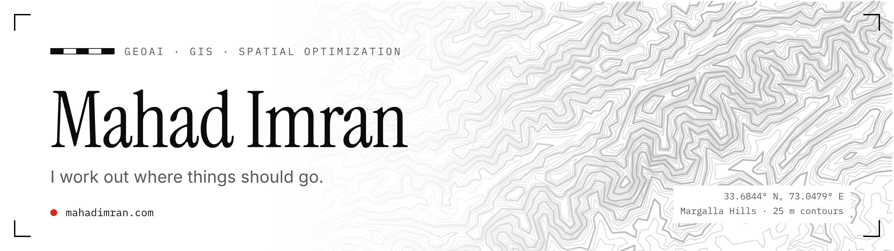
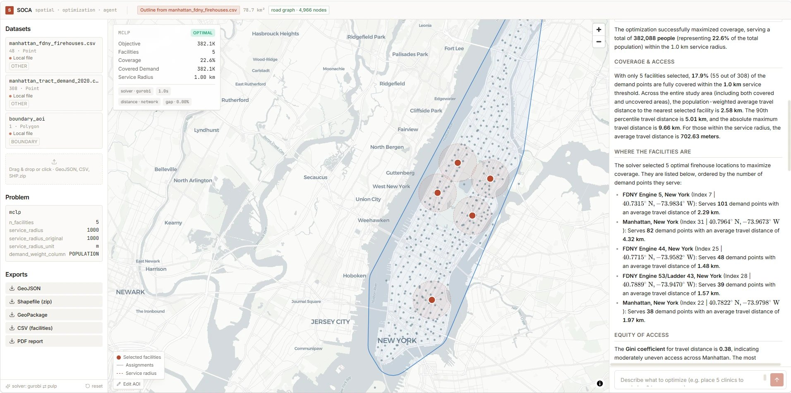
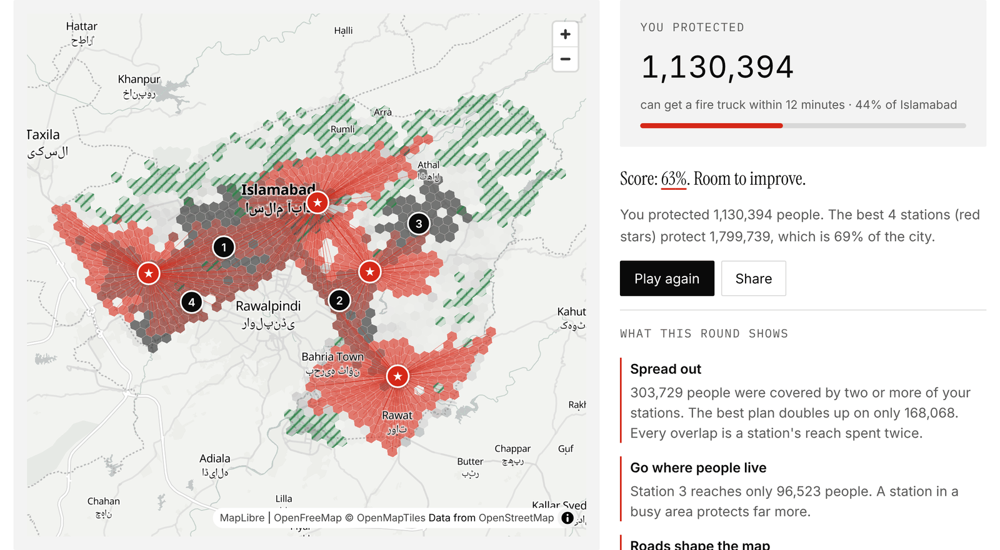
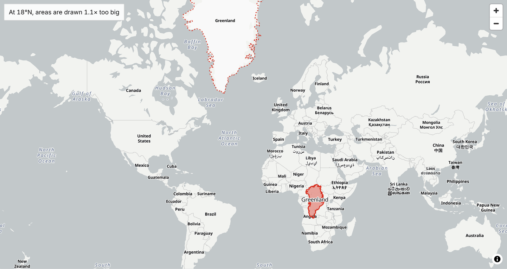
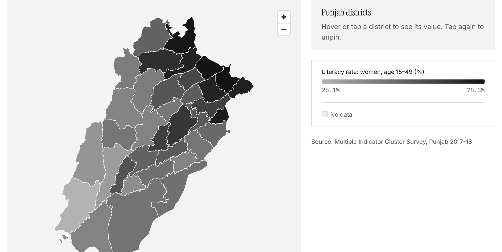

<a href="https://www.mahadimran.com">
  <picture>
    <source media="(prefers-color-scheme: dark)" srcset="assets/banner-dark.jpg">
    
  </picture>
</a>

  
  
  
  
  

I'm a **geospatial data scientist and GIS consultant**. I work on **spatial optimization**, **location intelligence** and **GeoAI**: picking which neighbourhoods a store should open in, or where a city should put its fire stations so help arrives in time. I also use LLMs to automate the slow, repetitive parts of GIS.

Before GIS I spent five years building education startups in Pakistan and coached 300+ people into jobs. I still think like a founder: ship something useful, then make it rigorous.

### 🔭 Currently

- 📄 **New paper:** [SOCA: A Conversational Agent for Facility Location Problems](https://doi.org/10.3390/ijgi15110494), out in *ISPRS IJGI* (2026)
- 🧭 Building tools that let planners describe siting problems in plain English and get exact answers back
- ✍️ Writing practical, tested GIS guides at [mahadimran.com/blog](https://www.mahadimran.com/blog)
- 🤝 Open to GIS consulting and research collaborations

### 📄 Research: SOCA

Describe a siting problem in plain English and [**SOCA**](https://github.com/CONFUZ3/SOCA) solves it exactly. The LLM only picks the formulation and extracts parameters through schema-checked function calls. Deterministic tools fetch boundaries, population and road networks from open data, then solve P-Median, P-Center, MCLP or LSCP, matching the `spopt` reference optima on all four. [Read the paper →](https://doi.org/10.3390/ijgi15110494)

### 📌 More projects

| Project | What it does | Stack |
| --- | --- | --- |
| [**sen2auto**](https://github.com/CONFUZ3/sen2auto) | Sentinel-2 pipeline for provincial-scale crop monitoring. Mosaics across UTM zones with cloud-aware compositing and computes NDVI, NDRE and GNDVI. | Python, rasterio, GeoPandas, Streamlit |
| [**GeoLint**](https://github.com/CONFUZ3/geolint) | Linter and auto-formatter for spatial data. Validates geometry, catches CRS mismatches and repairs invalid shapes in batch. | Python, Shapely, GeoPandas, Streamlit |
| [**LLM-SDSS**](https://github.com/CONFUZ3/llm-sdss) | Spatial decision support from plain-English criteria. Runs weighted overlay and returns ranked sites with a map and PDF report. | Python, PostGIS, Gemini API |
| [**ClickyWindows**](https://github.com/CONFUZ3/ClickyWindows) | Push-to-talk AI voice companion for Windows that flies its cursor to whatever it mentions on screen. | C#, .NET 8, Gemini Live API |
| [**EstateView**](https://github.com/CONFUZ3/EstateView) | GIS dashboard for exploring real estate plots, sectors and roads with live filtering. | React, MapLibre GL, shpjs |

### 🕹️ Play with a map

**[Site Selection Showdown](https://www.mahadimran.com/site-selection)**: be the fire chief. Place stations in Islamabad, Bahawalpur or Calgary, then reveal the optimal plan and see how close you got.

<table>
  <tr>
    <td width="50%" valign="top">
      
       <b><a href="https://www.mahadimran.com/true-size">True Size Map</a></b> 
      Drag Greenland to the equator and watch it shrink. Then compare Mercator, Equal Earth, Robinson and more.
    </td>
    <td width="50%" valign="top">
      
       <b><a href="https://www.mahadimran.com/punjab-education">Punjab Education Map</a></b> 
      30+ education indicators across Punjab's 36 districts, from literacy to gender parity.
    </td>
  </tr>
</table>

### ✍️ Recent writing

- [The Fastest Point-in-Polygon Join in Python, Benchmarked to 10 Million Points](https://www.mahadimran.com/blog/point-in-polygon-python-benchmark)
- [Can LLMs Do GIS? Where They Fail, and the Pattern That Works](https://www.mahadimran.com/blog/can-llms-do-gis)
- [Which H3 Resolution Should You Use?](https://www.mahadimran.com/blog/h3-hexagon-resolution-guide)
- [Fire Station Location Analysis: How Coverage Models Decide Where Stations Go](https://www.mahadimran.com/blog/fire-station-location-analysis)
- [Shapefile vs GeoPackage vs GeoParquet vs FlatGeobuf vs GeoJSON, Benchmarked](https://www.mahadimran.com/blog/geospatial-file-formats-compared)

➡️ [All articles](https://www.mahadimran.com/blog)

### 🧰 Toolbox

  
  
  
  
  
  
  
  
  
  
  
  

**Also:** Shapely · rasterio · OSMnx · H3 · spopt · PuLP · Sentinel-2 · Landsat · LLM function calling

---

  📍 Islamabad, Pakistan · 33.6844° N, 73.0479° E Off the clock: coffee, education, and CS2. If you want to talk maps, ask me anything.

